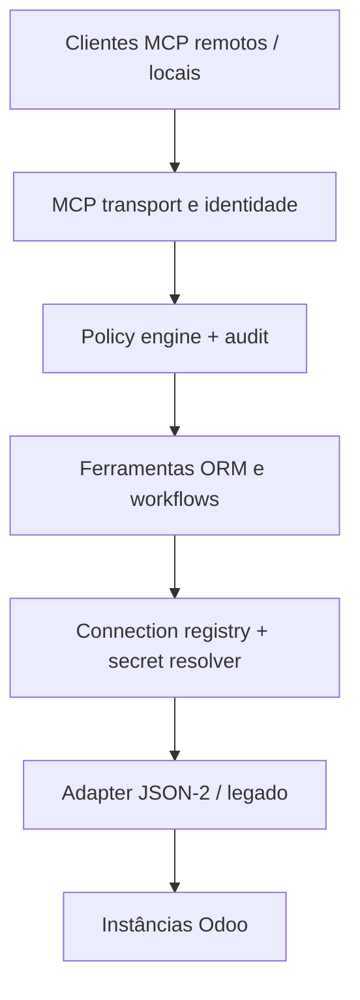

# Monynha Odoo MCP — Especificação de arquitetura

**Estado:** proposta para revisão · **Data:** 2026-10-27 · **Repositório:** `marcelo-m7/odoo-remote-mcp`

## 1. Visão e objetivo

Criar um servidor MCP original, open source, remoto e extensível que permita a agentes autorizados trabalhar com instâncias Odoo de forma segura, auditável e previsível. O produto deverá servir integrações da Monynha Softwares, Corvanis, FACODI e projetos de clientes, sem misturar credenciais, dados ou permissões.

O Odoo MCP 2 constitui **referência comportamental**, não fonte de código. A auditoria anterior reportou 35 ferramentas, quatro templates de recursos e gestão de múltiplas conexões. Essa contagem é um inventário inicial a reconfirmar com testes de contrato; não constitui prova de compatibilidade operacional.

### Objetivos

1. Oferecer pesquisa, leitura, escrita controlada, descoberta de esquema e agregação através de contratos MCP tipados.
2. Suportar Odoo 19 prioritariamente por JSON-2 e versões/implantações legadas através de adaptadores isolados.
3. Operar via **Streamable HTTP protegido** e, com o mesmo motor, via `stdio` para desenvolvimento local.
4. Garantir segregação explícita por organização, identidade MCP e conexão Odoo.
5. Fornecer políticas de segurança, aprovações, trilha de auditoria e erros explicáveis.
6. Permitir uma camada futura de workflows de negócio, skills e extensões para módulos Odoo.

### Não objetivos da primeira entrega

- Reproduzir código privado ou contornar controles do Odoo MCP 2.
- Construir um SaaS comercial completo, faturamento e painel administrativo complexo.
- Executar `sudo`, Python arbitrário, métodos internos indiscriminados ou SQL direto.
- Contornar ACLs, regras de registro, licenças e limites de planos Odoo.
- Prometer transações atômicas entre chamadas Odoo distintas.
- Conectar ou alterar FACODI, Boa Vista ou qualquer produção nos testes iniciais.

## 2. Abordagens consideradas

| Alternativa | Benefício | Custo ou limitação |
| --- | --- | --- |
| Servidor local apenas (`stdio`) | Menor superfície de ataque e entrega inicial mais simples | Insuficiente para clientes remotos e operações centralizadas |
| SaaS multi-tenant completo desde o início | Produto comercial pronto mais cedo | Multiplica requisitos de autenticação, billing, UI e operação |
| **Gateway modular híbrido, remoto-first** | Compartilha o núcleo entre clientes remotos e execução local, evoluindo sem reescrita | Exige identidade, autorização e isolamento desde a primeira versão remota |

**Proposta selecionada para aprovação:** gateway modular híbrido, com execução remota como cenário principal; servidores locais usam as mesmas políticas. O código é original e público sob a licença MIT já existente no repositório. A escolha do provedor de hosting permanece desacoplada (imagem Docker/ASGI).

## 3. Arquitetura e limites de confiança



**Camadas propostas (Python 3.12+):**

- **Transport:** SDK Python oficial MCP; Streamable HTTP e `stdio`, com contratos Pydantic.
- **Identity / authorization:** autenticação MCP independente das chaves Odoo; OIDC/OAuth para utilização remota, validação de audience e scopes; autenticação administrativa separada.
- **Application:** comandos tipados, validação de domínio/argumentos, limites de resultado, cancelamento, tempo limite e orquestração.
- **Policy:** restrições por `principal_id`, `organization_id`, `connection_id`, modelo e operação; aprovação explícita de ações de alto risco.
- **Adapters:** interface `OdooAdapter`; `Json2Adapter` prioritário; `LegacyRpcAdapter` apenas quando compatível e autorizado.
- **Persistence:** PostgreSQL para metadados, políticas e auditoria da implantação hospedada; referência a segredos externos em vez de valores secretos na base de dados.
- **Deployment:** Docker e health checks para ambiente hospedado; `stdio` para execução local.

O cliente MCP nunca escolhe uma organização arbitrariamente. A identidade autenticada determina quais conexões podem ser usadas. Não haverá conexão global “ativa” compartilhada no processo remoto; **cada chamada recebe `connection_id` ou usa uma preferência estritamente vinculada à identidade autenticada**.

## 4. Modelo de domínio

- `Principal`: identidade autenticada do cliente MCP.
- `Organization`: limite de isolamento dos projetos/clientes.
- `Membership`: papel e permissões do principal numa organização.
- `Connection`: URL normalizada, nome da base de dados opcional, versão/capacidades detectadas e referência de segredo.
- `Policy`: permissões `read/create/update/delete/execute/admin`, restrições de modelo, método, contexto e operação.
- `Approval`: pedido de aprovação com expiração, fingerprint da operação e decisão registrada.
- `AuditEvent`: quem/quando/o quê, conexão, modelo, IDs afetados, decisão, duração, resultado e correlation ID; sem chaves, passwords ou campos sensíveis em claro.

O identificador de organização faz parte das consultas de persistência; referências cruzadas entre organizações falham por padrão.

## 5. Compatibilidade Odoo e contrato de transporte

### Odoo 19 / JSON-2

- `POST /json/2/<model>/<method>`, JSON com argumentos nomeados, `ids` e `context`, Bearer API key e `X-Odoo-Database` quando necessário.
- Descoberta de capacidades por instância; métodos e módulos não são presumidos a partir da versão.
- Cada chamada JSON-2 executa uma transação própria. Operações críticas que exigem atomicidade devem usar método único de negócio, ou módulo auxiliar específico, **não** uma sequência de chamadas MCP tratada como transação.
- O acesso à API externa pode depender do plano Odoo; detectar incompatibilidade e dar erro explícito, sem tentar contornar condições de licença.
- As permissões nativas do utilizador Odoo continuam a prevalecer.

### Compatibilidade legada

- Adaptador isolado para XML-RPC/JSON-RPC nas versões e implantações em que o acesso estiver disponível.
- Seleção por verificação segura de capacidade (sem credenciais em URL ou logs); nenhuma queda silenciosa entre mecanismos.
- Tratamento normalizado de autenticação, permissões, erros de validação, conflitos, throttling e indisponibilidade.

### Desenho de chamadas

- Timeout por operação, budget total da chamada e tamanho máximo de payload.
- Repetições apenas de leituras idempotentes por padrão; escritas exigem mecanismo verificável de idempotência ou ficam sem retry automático.
- `context` com lista de chaves permitidas; recusar escaladas como `sudo` ou mudanças de identidade.
- Respostas estruturadas com `data`, `meta` (conexão, duração, paginação, correlation ID) e `error` (código estável e mensagem segura).

## 6. Catálogo de ferramentas — primeira versão

| Ferramenta proposta | Operação | Controle inicial |
| --- | --- | --- |
| `server_info_get` | Versão MCP, capacidades e modos habilitados | Leitura |
| `connection_list` | Listar somente conexões acessíveis ao principal | Leitura |
| `connection_test` | Validar acesso e capacidade de uma conexão existente | Leitura |
| `model_list` | Pesquisar modelos visíveis | Leitura |
| `model_fields_get` | Campos, tipos, relacionamentos e características de acesso | Leitura |
| `record_get` | Ler registros por ID e campos permitidos | Leitura |
| `record_search` | Domínios Odoo, paginação, ordenação, campos | Leitura |
| `record_count` | Contagem por domínio | Leitura |
| `record_aggregate` | Agrupamento/estatísticas usando ORM disponível | Leitura |
| `record_create` | Criar com validação e auditoria | Escrita restrita |
| `record_update` | Atualizar por IDs com validação e auditoria | Escrita restrita |
| `record_delete` | Eliminar apenas com permissão + aprovação | Desabilitada por padrão |

A criação/edição de conexões e credenciais será feita por administração autenticada (não por agentes comuns). `method_execute` genérico, `record_import`, chatter, binários, wizards, pagamentos, instalações de módulos, skills e administração multiusuário são extensões posteriores, sempre com allowlists e aprovações.

Compatibilidade de nomes e schemas com o MCP 2 será medida com fixtures de contrato e mapeamentos documentados, sem prometer equivalência de comportamento antes de testá-la.

## 7. Segurança: requisitos não negociáveis

1. Endpoint HTTP público **nunca** anônimo: validação de token, audience, issuer, expiração, scopes e vínculo da organização. Implementação conforme a especificação MCP Authorization aplicável, incluindo metadata de recurso protegido quando exigido.
2. Credenciais Odoo resolvidas no servidor por referências a secret manager; sem retorno nos resultados de ferramentas, logs, traces, exceptions ou mensagens ao modelo.
3. URLs de instâncias registradas apenas por administradores; `https` obrigatório em produção, proibição de endereços privados, loopback, link-local e metadata endpoints para prevenir SSRF; validar DNS em conexão e redirecionamentos.
4. Princípio de menor privilégio para utilizadores técnicos Odoo; nunca tentar burlar ACLs, record rules ou field access.
5. Deny-by-default para `unlink`, métodos arbitrários, instalação de add-ons, pagamentos e efeitos externos.
6. Aprovações vinculadas ao conteúdo exato da operação, alvo, ator e prazo; alteração dos argumentos invalida aprovação anterior.
7. Rate limiting por principal e conexão, cotas por operação, resposta truncada de forma segura e limites de concorrência.
8. Auditoria imutável ou append-only, com mascaramento de dados pessoais e retenção configurável.
9. Esconder `debug` e tracebacks de erros Odoo dos agentes; disponibilizar detalhes sensíveis somente em logs operacionais protegidos.
10. Verificações de dependências, secret scanning, testes de isolamento e política explícita de divulgação de vulnerabilidades.

## 8. Testes e critérios de aceitação

**Automatizados (sem Odoo real):**

- Conformance MCP (descoberta, schema, resultado e erro) em `stdio` e HTTP.
- Contratos adaptadores JSON-2/legado com respostas Odoo simuladas.
- Domínios, campos, paginação, agregações e Unicode; limites e timeouts.
- JWT inválido, audience errada, scopes insuficientes, mistura de organizações/conexões, SSRF e tentativas de segredos em logs.
- Operações destrutivas recusadas sem política/aprovação e retries inseguros desativados.

**Integração (apenas ambiente descartável ou staging com autorização explícita):**

- Duas instâncias segregadas, API keys distintas.
- Descoberta de `res.partner` e `ir.model` (conforme ACL), `search_read` e `read_group` quando disponíveis.
- CRUD num modelo de teste dedicado, com limpeza controlada.
- Um cliente MCP local e um cliente remoto autenticado.
- Erros tipados para licença/plano sem API, autenticação inválida e falta de permissões.

**Critério de saída da v0.1:** testes automatizados verdes, demonstração end-to-end em staging, documentação de setup com variáveis fictícias, matriz de capacidades confirmada por ambiente e revisão de segurança. Nenhuma credencial real nem acesso a produção na CI.

## 9. Estrutura sugerida

```text
src/monynha_odoo_mcp/
  server.py             # registro MCP / transports
  settings.py           # configurações tipadas
  auth/                 # identidade e tokens remotos
  policy/               # autorização de ações e aprovações
  connections/          # registry e resolução de segredos
  odoo/                 # protocolo de adapter e implementações
  tools/                # contratos MCP por domínio
  audit/                # eventos e trilhas operacionais
tests/
  unit/
  contract/
  integration/
docs/
  architecture/
  superpowers/specs/
```

Cada componente deve ter interfaces testáveis independentemente do transporte MCP. API administrativa e UI poderão ser acopladas sem expor segredos às ferramentas do agente.

## 10. Entregas incrementais

- **v0.1 — Núcleo remoto seguro:** identidade, segregação, conexão, JSON-2, descoberta, pesquisas, CRUD controlado, testes simulados e deployment Docker.
- **v0.2 — Operações Odoo:** métodos allowlisted, workflows/wizards, importação idempotente, anexos e chatter.
- **v0.3 — Organizações e operação:** roles/grupos avançados, políticas administráveis, vault, observabilidade, auditoria e instalação auto-hospedada.
- **v0.4 — Especialização:** ferramentas CRM, Website/eLearning, Project, Field Service, Inventory, Accounting e skills; matriz Community/Enterprise/Odoo Online/Odoo.sh.

### Decisões de produto ainda por validar

1. **Escopo inicial:** remoto-first com `stdio` incluído, ou `stdio` primeiro e remoto após autenticação completa?
2. **Identidade remota:** reutilizar um provedor OIDC existente (recomendado) versus hospedar um Authorization Server próprio.
3. **Deploy piloto:** Coolify/Docker existente versus outro serviço; não condiciona o desenho do núcleo.
4. **Política de escrita:** `create/update` com allowlists na v0.1; `delete` só após aprovação e testes de segurança.
5. **Nome público:** repositório `odoo-remote-mcp` e pacote Python `monynha-odoo-mcp`.

**Nenhuma destas opções implica autorização para operar instâncias de produção.**

## 11. Referências primárias

- [Odoo 19 — External JSON-2 API](https://www.odoo.com/documentation/19.0/developer/reference/external_api.html)
- [Odoo 19 — API Keys e compatibilidade](https://www.odoo.com/documentation/19.0/developer/misc/api/external_api.html)
- [MCP — Authorization](https://modelcontextprotocol.io/specification/2025-11-25/basic/authorization)
- [SDK Python oficial MCP](https://github.com/modelcontextprotocol/python-sdk)

## 12. Próximo gate

Rever e aprovar esta especificação antes de scaffolding ou implementação de produto. Depois, decompor a v0.1 num plano de tarefas testáveis (TDD), criar CI e abrir um PR de implementação separado. Este documento é uma **proposta**, não uma alegação de funcionalidade pronta.
