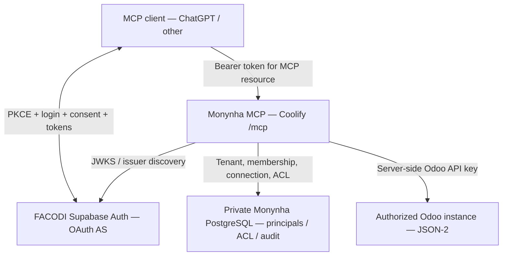

# Monynha Odoo MCP — Supabase FACODI OAuth 2.1 Integration Design

**Status:** design for review, not authorization to deploy.

**Date:** 2026-10-27.

**Repository:** `marcelo-m7/odoo-remote-mcp`.

**Target branch:** `docs/supabase-facodi-oauth21` → draft PR against `main`.

**Decision made by Marcelo:** reuse the FACODI Supabase project as the OAuth authorization server; no automatic merge.

**In scope now:** specification only. No Supabase configuration, database migration, production login change, or MCP deployment is authorized by this PR.

> **Resumo executivo (PT):** O Supabase Auth já utilizado pela FACODI será o provedor OAuth 2.1 do Monynha MCP. A identidade poderá ser comum, mas acesso às organizações, conexões Odoo, modelos e operações continuará exclusivamente sob controlo de políticas privadas do Monynha. O plano exige tokens emitidos especificamente para o recurso MCP, consentimento explícito, testes contra acessos cruzados e bloqueio global de escritas. Este documento não modifica o Supabase nem autoriza deploy.

## 1. Purpose and success criteria

The Monynha Odoo MCP will accept **OAuth 2.1 access tokens issued by FACODI's existing Supabase Auth project** while preserving independent, deny-by-default Monynha entitlements. ChatGPT and other compliant MCP clients can authenticate interactively without receiving Odoo API keys or a Supabase service key.

Reuse the identity provider, **not** FACODI's Odoo privileges, Supabase database grants, application roles or business data. Reuse must not break existing FACODI sessions, logins, Supabase JWT audiences, RLS policies or deployment paths.

Acceptance requires: OAuth discovery → PKCE login → explicit consent → appropriately audience-bound access token → authenticated MCP initialization and read-only Odoo access **only** for a separately onboarded Monynha principal. Another authenticated FACODI user, an unapproved OAuth client, or another organization's principal must be denied.

### Non-goals

- No new Keycloak/Auth0 service or proprietary OAuth authorization server inside the MCP.
- No migration of Monynha metadata, Odoo credentials or policy tables into FACODI's Supabase database.
- No writes to Odoo during the initial rollout; no automatically approved or implicit `create`/`update` privileges.
- No public SaaS registration, billing, tenant self-service, production deployment or merge in this documentation PR.
- No new ability to read FACODI tables or Odoo records because an OAuth token exists.

## 2. Alternatives and decision

| Approach | Trade-off | Decision |
| --- | --- | --- |
| Keycloak/Auth0 as a separate identity provider | Strong product isolation but another account/service and user lifecycle | Not selected |
| Accept existing FACODI session JWTs (`aud=authenticated`) as MCP bearer tokens | Easiest technically, but risks token reuse across resources and violates MCP audience separation | **Rejected** |
| **Supabase FACODI OAuth 2.1 Server**, scoped clients/tokens and Monynha policy database | Reuses identity and PKCE/consent, but needs careful audience, client and user isolation | **Selected** |

Supabase's OAuth 2.1 server is presently documented as **beta**. The project must actually support and enable this feature, use asymmetric JWT signing, and expose the expected discovery endpoints. Do not infer availability from the mere existence of Supabase Auth.

## 3. Deployment and trust boundaries

1. **Authorization server:** the pre-existing FACODI Supabase project; its concrete project reference is a deployment value, deliberately not committed here. Canonical Auth issuer is expected to be `https://<facodi-project-ref>.supabase.co/auth/v1`; **verify against live OIDC/OAuth discovery** before configuring.
2. **Protected resource:** the existing Python MCP Streamable HTTP service at `https://<approved-mcp-domain>/mcp`; public HTTPS terminated by the Coolify reverse proxy; container listens on port `8000`.
3. **Metadata store:** the MCP's own PostgreSQL (`organizations`, `principals`, `memberships`, `connections`, `policies`, `audit`); *not* the FACODI Supabase Postgres. The Coolify PostgreSQL dependency is detailed by PR #3, still pending merge when this design was written.
4. **Odoo credential:** a least-privilege technical Odoo user's API key in Coolify runtime secrets, referenced as `env:MONYNHA_ODOO_KEY_*`, never sent to Supabase, the browser, or an MCP client.
5. **OAuth token:** accepted only by Monynha's bearer-auth middleware after checking cryptographic signature, `iss`, resource-bound `aud`, expiry/time claims, `sub`, permitted client identity and server-managed access grants. **Never forward this bearer token to Odoo**.

### Existing code and change surface

| Existing component | Current behavior | Required evolution in a future implementation PR |
| --- | --- | --- |
| `server.py` | MCP SDK bearer middleware, protected-resource metadata, JWT verifier, subject→principal, health routes | Preserve transport; enforce tenant/client gates and read-only switch centrally |
| `auth/oidc.py` | RS256/ES256 JWKS validation, exact audience, hard-required `mcp:odoo` scope | Supabase-specific claims validation without treating standard OIDC scopes as Odoo authorization |
| `settings.py` | Requires issuer/JWKS/audience/public URL in HTTP mode | Add explicit OAuth-provider/client restriction settings and `WRITES_ENABLED=false` |
| `connections/sql_store.py` and `policy/engine.py` | Persist principals, org memberships, model/operation policies; grants can include create/update | Enforce authenticated issuer+subject mapping, client restrictions and global write deny independently of grants |
| `docs/security.md` / `docs/deployment/coolify.md` | Generic external OIDC and runtime secret guidance | Document FACODI-specific steps without adding credentials; account for Compose PR #3 |

All paths above are relative to `src/monynha_odoo_mcp/` unless prefixed with `docs/`.

## 4. Identity and authorization isolation

**Authentication is not membership.** A successful FACODI login only proves identity. It does not create a Monynha principal, organization membership, connection grant or Odoo policy. A denied user sees no connections or business metadata.

- Use the tuple **(`iss`, `sub`)** as the durable external identity, not email or an editable `user_metadata` claim. Resolve that tuple to a server-owned `principal_id` in the Monynha database. Define a migration/backfill rule for existing `principal_id=sub` rows; never silently orphan existing grants or collapse identities from distinct issuers.
- Record `client_id` as the OAuth application identity and require explicit client admission, initially a small **pre-registered allowlist**. A client being registered in Supabase is not by itself admission to Monynha data. Bind consent, access audit and revocation to the client identity.
- Scope every authorization query to the authenticated principal **and** membership's `organization_id`, then to a connection owned by that organization, then to the permitted model/operation. Do not accept a tenant ID or connection ID supplied by the model as proof of authorization.
- Preserve the existing least-privilege Odoo technical-account ACLs and record rules as an **additional** restriction. No Odoo permissions flow from FACODI profiles, Supabase `authenticated` role, OIDC scopes or broad Supabase RLS policies.
- Never make decisions based on mutable `raw_user_meta_data`. If any FACODI-side app metadata is consulted, it must be server-managed and independently verified; the canonical Monynha ACL remains in its own PostgreSQL.
- Do not add tables to FACODI's exposed `public` schema for Monynha permissions. If a future shared table is explicitly approved, create a dedicated protected schema and review grants/RLS separately.

**Tenant collision tests:** two FACODI users with different Monynha memberships, one user belonging to two Monynha organizations, two connections with the same friendly label, and a token from a non-Monynha OAuth client must never produce cross-organization access.

## 5. OAuth 2.1 and JWT interoperability contract

### Endpoints and discovery

- MCP resource: `https://<approved-mcp-domain>/mcp`.
- MCP Protected Resource Metadata: `https://<approved-mcp-domain>/.well-known/oauth-protected-resource/mcp`, advertising the canonical protected resource and the **Supabase Auth issuer**.
- Expected Supabase discovery: `https://<facodi-project-ref>.supabase.co/.well-known/oauth-authorization-server/auth/v1` (confirm live).
- Expected signing keys: `https://<facodi-project-ref>.supabase.co/auth/v1/.well-known/jwks.json` (derive from discovery; do not blindly hardcode).
- An unauthenticated `/mcp` request returns `401` with useful `WWW-Authenticate` resource metadata; insufficient permitted scope/grant returns the protocol-appropriate denial without leaking details.
- Keep the **well-known routes publicly reachable** through Coolify; protect `/mcp` itself. The proxy must not route only the `/mcp` prefix.

### Interactive flow

1. MCP client discovers resource metadata and the Supabase authorization server.
2. Client registers or uses an existing OAuth client ID and starts authorization-code + **PKCE S256** with exact registered HTTPS/localhost redirect URI, `state`, and the OAuth resource indicator set to the full canonical MCP URL.
3. Supabase Auth redirects to the configured **FACODI-hosted authorization/consent UI**. The UI preserves `authorization_id`, requires authenticated user, displays the requesting client/redirect/scope and supports explicit approve/deny.
4. Supabase issues a short-lived code, then tokens; the client sends only an MCP-specific access token to `/mcp`.
5. The MCP verifies issuer/signature/audience/expiry/subject/client and resolves its **own** authorization context before exposing any tool data.

**Consent-route dependency:** inspect FACODI's current Supabase `SITE_URL`, redirect list, and available frontend routing *read-only* before choosing `/oauth/consent`. Do **not** change the project's global Site URL simply to host a Monynha consent screen; that could disrupt existing FACODI login and password-reset flows. If the current site cannot host consent safely, propose an explicit frontend/routing change and get approval before deploying it.

### Critical audience and scope gate

Supabase documents that normal OAuth access tokens may have **`aud=authenticated`**, whereas the existing Monynha MCP requires `aud` to equal its resource URL and demands `scope=mcp:odoo`.

- **Never relax MCP validation to accept `aud=authenticated`.** Do not accept Supabase ID tokens, anon keys, service-role keys or ordinary FACODI frontend sessions as MCP access tokens.
- Design a **Supabase Custom Access Token Hook**, gated to the approved OAuth client/resource association, to issue the MCP-specific `aud`; make its changes conditional so **non-Monynha FACODI logins and tokens retain their current claims**. Preserve all required Supabase claims and test existing FACODI RLS/REST behavior before activation.
- Supabase's documented standard scopes (`openid`, `email`, `profile`, `phone`) describe identity data, **not** Odoo authorizations. Validate whether a custom `mcp:odoo` scope is actually issuable and advertised in this project's OAuth Server. If not, update the provider-specific verifier contract: accept only a correctly bound MCP audience + admitted `client_id` + valid `sub`, then apply the server's Monynha membership/connection/model policies. Never reinterpret `openid` as `mcp:odoo` permission.
- **RFC 8707 resource binding is a verification gate.** Test whether Supabase accepts the `resource` parameter in *both* authorize and token requests and whether the resulting access token is demonstrably MCP-targeted. A hook mapping a shared client to a fixed audience is not proof of general resource-indicator support. Do not enable public dynamic client registration or production use until effective token binding is established.
- OAuth client ID and audience must not be derived from user-supplied untrusted metadata. Client IDs admitted to Monynha must be bound to the approved resource through verified server-managed configuration.

### Registration policy

**Pilot:** pre-register a dedicated Monynha OAuth client; require explicit consent, exact redirect URI and restricted test users. Leave public dynamic client registration disabled.

**Later:** enable Supabase Dynamic Client Registration only after confirming audience binding, per-client audit/revocation, redirect validation, abuse controls, and E2E behavior with the targeted ChatGPT MCP client. The beta feature and available client registration modes must be rechecked at implementation time.

## 6. Writes, secrets and shared-project risk controls

1. Implement a server-enforced global `MONYNHA_MCP_WRITES_ENABLED=false` switch. The policy engine and service layer reject `create`, `update` and all side-effecting tools before sending anything to Odoo even if a legacy DB policy grants them. `delete` and arbitrary methods remain unavailable. Do not rely only on hiding tool descriptions.
2. The MCP needs Supabase **public discovery/JWKS**, not a Supabase `service_role` or secret API key. Secrets for Odoo and private PostgreSQL remain runtime-only in Coolify; never store them in FACODI's Supabase tables or expose them in UI or GitHub.
3. Keep Supabase signing keys asymmetric (RS256/ES256 supported by current verifier). Check the existing FACODI signing-key configuration and migration impact before any rotation or signing-mode change; **never** switch the shared project to a new signing mode without verifying FACODI clients.
4. Session revoke/sign-out does not necessarily invalidate already-issued JWTs immediately. Favor short token TTL, explicit principal/client revocation checked server-side on each request, and audited access. For especially sensitive operations, verify active session state via an approved server-to-server mechanism rather than assuming JWT expiry equals immediate revocation.
5. Use separate admin-controlled onboarding for Monynha organizations, memberships and connection grants. The FACODI user's `sub` gives **no default access**.
6. Never forward a Supabase OAuth token to Odoo; only send the separately configured Odoo technical-user API key to its approved hostname.
7. Audit authorization failures, client identity and connection/organization access attempts without storing bearer tokens, API keys, email addresses by default or entire records.

## 7. Phased implementation and file-level work package

**Phase A — read-only discovery / compatibility spike**

- Inspect OAuth Server enablement, discovery, `jwks_uri`, signing algorithm, custom claims hook behavior, registration features, current FACODI Site URL/redirects, and `resource` handling, without updating the Supabase project.
- Capture non-secret evidence and run **offline/mock contract tests**. A real OAuth token exchange requires an enabled OAuth server, a registered client and a working consent route, which may require changes to Supabase; do not perform that exchange in this read-only phase unless all prerequisites already exist without mutation. If RFC 8707/audience, PKCE discovery or consent cannot work without impacting FACODI, stop and revise the design rather than weakening validation.

**Phase B — implementation in a separate PR, after design approval**

- Add configurable provider adapters / exact JWT claim validation in `auth/oidc.py`, settings and security tests; preserve the generic OIDC behavior where feasible.
- Add issuer+subject principal mapping, authorized OAuth client admission and tenant-scoped policy lookups in the MCP's private database, with migration from existing principals.
- Add the global write kill switch in `settings.py`, `policy/engine.py` and the service boundary, with direct denial tests.
- Implement the FACODI-compatible consent page in the relevant **frontend repository** only after routing is chosen; implement the scoped access-token hook in the **FACODI Supabase project** only after an impact review and explicit deployment approval.
- Update `README.md`, `docs/security.md`, Coolify guidance and relevant CI tests. Reconcile with the PR #3 Compose branch; no assumption that PR #3 has already merged.

**Phase C — staging, not production**

- **Blocking environment choice before any Supabase write:** Marcelo must approve either an isolated staging Supabase project with equivalent Auth/OAuth settings or a tightly scoped pilot configuration in the **existing FACODI project** (including the corresponding risk review). The present decision to reuse FACODI for eventual authentication does **not** authorize configuring its live OAuth server, registering clients, installing hooks or changing its Site URL. Document this choice and rollback before running live OAuth tests.
- Run OAuth login and consent through a real MCP client (including ChatGPT if available), verify `WWW-Authenticate`, protected-resource metadata, DCR fallback behavior, resource audience and denied user/client/tenant cases.
- Run allowed read-only tools against a controlled Odoo staging database; test with two independent organizations and API keys.
- Validate FACODI's existing login/session/refresh and RLS paths are unchanged, plus rotation, revoke, replay, expiration, unknown `kid`, audit, SSRF protections, Coolify HTTPS, `/readyz`, backup/restore and restart.

**Phase D — guarded production rollout (separate approval)**

- Ship read-only, one worker, one pilot OAuth client and a small explicit principal allowlist. Monitor denied access and audit. Keep writes off, and have the ability to withdraw the MCP route or revoke its OAuth client without disrupting FACODI.
- Enable additional MCP clients or dynamic registration gradually and only after every security gate passes.

## 8. Test and acceptance matrix

| Scenario | Required outcome |
| --- | --- |
| No bearer token / expired token / invalid signature or unknown `kid` | `401`; no data, no Odoo request |
| Standard FACODI JWT with `aud=authenticated` | Denied, even when the user is a Monynha member |
| Wrong issuer, ID token, service key or token intended for another resource | Denied; never accepted as MCP access token |
| Valid token from unapproved OAuth `client_id` | Denied, regardless of FACODI account privileges |
| Valid user and client, but missing Monynha principal/membership/policy | Denied and audited without leaking connections |
| User A requests user B's organization/connection | Denied for both list and direct-ID queries |
| One principal belongs to two orgs | Only explicitly granted connections/models visible; no implicit global connection |
| Allowed client/user, approved connection, permitted read | MCP initialize + tool read succeeds; only approved fields/records |
| `record_create` / `record_update` with pre-existing grant while writes OFF | Rejected **before** dispatch to Odoo, audited |
| Standard FACODI web login/session after OAuth hook deployment | JWT/redirect/RLS behavior unchanged |
| OAuth code flow with PKCE S256, exact redirect, state and resource | Successful consent, code exchange and audience-specific bearer access |
| Revoked client or principal | Subsequent tool request denied, regardless of unexpired JWT where revocation is server-enforced |
| MCP bearer token sent to an Odoo endpoint | **Must never occur**, including error and retry paths |
| Coolify reverse proxy metadata route | Both well-known discovery and `/mcp` reachable under HTTPS; `/readyz` reports readiness |

## 9. Rollback, operational gates and unanswered deployment inputs

- **Safe rollback:** disable Monynha app/route in Coolify and revoke only its OAuth client(s); restore previously reviewed MCP image/config. Do **not** disable all FACODI Auth/OAuth or rotate shared signing keys as a Monynha-only rollback.
- The identity hook needs a rollback-tested configuration snapshot so non-Monynha tokens remain unchanged; stage and review its blast radius before installing it in the shared FACODI project.
- Do not merge or deploy until the required client registration model, consent route and audience binding are verified and the automated/staging security tests pass.

**Decisions deliberately deferred for review:** (1) **the test environment and explicit authority for any OAuth/Supabase writes** (isolated staging project versus controlled FACODI pilot); (2) exact public MCP hostname; (3) compatible FACODI consent UI host/path and ownership; (4) whether Supabase OAuth currently issues a valid MCP `resource`-bound `aud` in this project; (5) whether to admit more than one OAuth client at the pilot stage; (6) deployment ordering relative to pending Coolify Compose PR #3. These are operational gates, not invented defaults.

## 10. Official references

- [Supabase — OAuth 2.1 Server](https://supabase.com/docs/guides/auth/oauth-server)
- [Supabase — Getting Started with OAuth 2.1 Server](https://supabase.com/docs/guides/auth/oauth-server/getting-started)
- [Supabase — Model Context Protocol Authentication](https://supabase.com/docs/guides/auth/oauth-server/mcp-authentication)
- [Supabase — Token Security / RLS and Custom Access Token Hook](https://supabase.com/docs/guides/auth/oauth-server/token-security)
- [Supabase — Custom Access Token Hook](https://supabase.com/docs/guides/auth/auth-hooks/custom-access-token-hook)
- [MCP — Authorization Specification](https://modelcontextprotocol.io/specification/2025-11-25/basic/authorization)
- [Coolify — Docker Compose applications](https://coolify.io/docs/applications/builds/docker-compose)

**Next gate:** Marcelo reviews and approves this design in the draft PR. A later implementation plan and product/code PR, plus separately authorized Supabase/frontend staging changes, follow only after that review.
